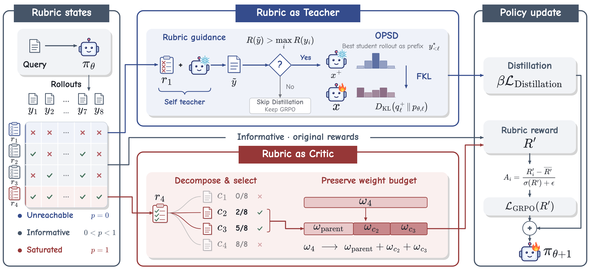
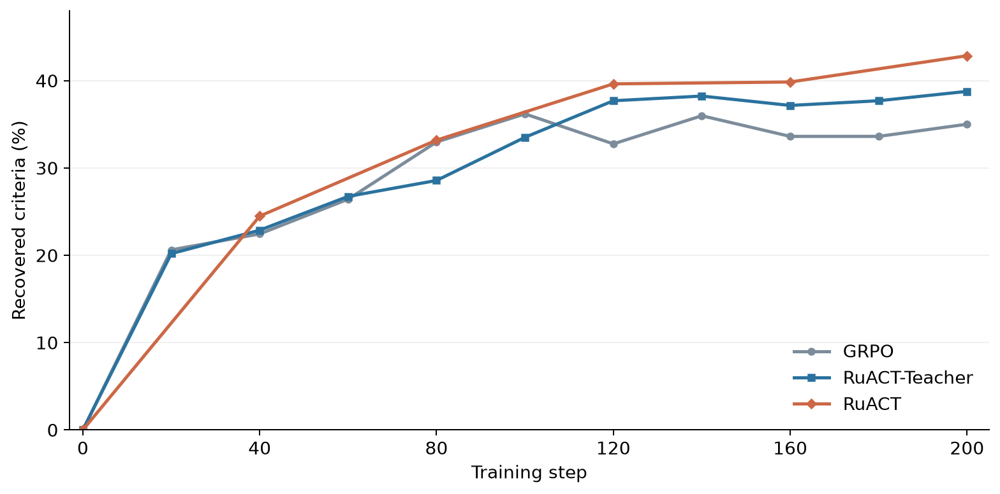
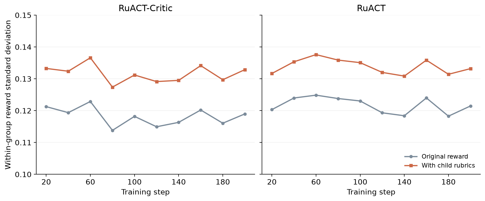
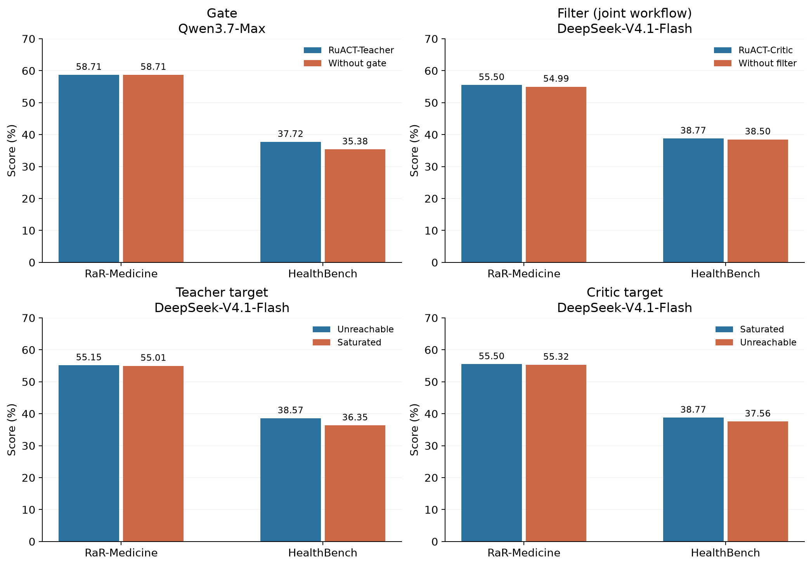

# RuACT

RuACT uses rubrics in two complementary roles: a **Teacher** supplies privileged guidance on requirements that sampled responses fail to meet, while a **Critic** turns already-satisfied requirements into more discriminative child criteria. Both components train the same policy through one shared `verl` implementation.

[Method](#method) · [Results](#benchmark-results) · [Analysis](#analysis) · [Quick start](#quick-start) · [Training guide](docs/training.md) · [Evaluation guide](docs/evaluation.md)

## Method



- **RuACT-Teacher** selects unreachable criteria, verifies the guided teacher response, and distills the privileged distribution on the selected student's response prefix.
- **RuACT-Critic** selects saturated positive criteria, proposes five candidates, and judges them on the same eight responses. If fewer than the required minimum survive, it performs **at most one feedback-driven regeneration round**. Each parent retains at most three children.
- **RuACT** combines the two components. The Teacher and Critic implementations are shared with their standalone variants.

The standard candidate filter accepts pass counts from 2 through 6 out of 8. Candidate regeneration is distinct from retrying a failed API request. Independent semantic validation is available as an explicit option; when disabled, the audit records that it was not performed. See [Critic settings](configs/methods/critic.json) and the [method details](docs/training.md#critic-policy).

## Benchmark results

Scores below are recovered checkpoint evaluations with **DeepSeek-V4.1-Flash**, in percent; higher is better. Fine-tuned models use step 200. Medicine and Science are separate training runs. HealthBench and ResearchQA use fixed 500-question subsets; RaR-Medicine and RaR-Science contain 2,242 and 2,292 evaluation questions.

| Model | Method | RaR-Medicine | HealthBench | RaR-Science | ResearchQA |
|---|---|---:|---:|---:|---:|
| 1.7B | Base model | 38.57 | 23.18 | 52.56 | 50.51 |
| 1.7B | GRPO | 43.26 | 26.45 | — | — |
| 1.7B | Reweight | 42.60 | 25.61 | 56.77 | 56.11 |
| 1.7B | RuscaRL | 43.39 | 23.95 | 56.41 | 59.37 |
| 1.7B | RuACT-Teacher | 43.82 | 25.16 | 58.42 | 57.76 |
| 1.7B | RuACT-Critic | 43.24 | 27.97 | 58.16 | 59.85 |
| 1.7B | RuACT | 43.35 | 27.83 | 56.83 | 57.55 |
| 4B | Base model | 50.38 | 35.45 | 66.16 | 59.16 |
| 4B | GRPO | 53.55 | 37.62 | 70.08 | 64.82 |
| 4B | Reweight | 55.34 | 38.46 | — | — |
| 4B | RuscaRL | 55.36 | 37.10 | 69.38 | 65.33 |
| 4B | RuACT-Teacher | 55.15 | 38.57 | 70.53 | 66.12 |
| 4B | RuACT-Critic | 55.50 | 38.77 | 70.47 | 64.62 |
| 4B | RuACT | 56.34 | 40.12 | 70.59 | 69.44 |

Values preserve the verified metric records: RaR-Science uses explicit weights; Medicine-4B uses the archived score summary, and the other columns use their verified aggregates. No cross-benchmark average is reported. A dash means the result is not established for that method: the Science-1.7B run previously labelled GRPO used a Teacher recipe, and Science-4B Reweight is unavailable. These historical scores are not fresh reruns of the consolidated code. [Values and source digests](analysis/data/checkpoint_scores.csv) · [Metric and comparability notes](analysis/README.md)

## Analysis

### Recovering unreachable criteria



On a fixed cohort of **931 initially unreachable criteria across 331 Medicine training queries**, a criterion is recovered if at least one of eight new responses satisfies it. At step 200, recovery is **35.02%** for GRPO, **38.78%** for RuACT-Teacher, and **42.86%** for RuACT. These are checkpoint-specific recovery rates, not cumulative counts.

### Making the reward more discriminative



Each panel compares original and child-augmented rewards on the **same responses within one run**, over all 12,800 groups. Points average consecutive 20-step windows; no groups are excluded. Mean within-group standard deviation changes from **0.1182 to 0.1316** for RuACT-Critic and from **0.1217 to 0.1339** for RuACT. Dispersion is a mechanism diagnostic, not a measure of answer quality by itself.

### Critic case study

**Query:** What is the treatment plan for opiate intoxication?

| Criterion | Requirement | Passing responses |
|---|---|---:|
| Parent | Emphasizes patient safety and continuous monitoring during treatment. | 8 / 8 |
| Child: airway maintenance | Specifies immediate measures to maintain a patent airway before pharmacological reversal. | 2 / 8 |
| Child: cardiac monitoring | Calls for continuous cardiac monitoring for arrhythmias or hypotension. | 4 / 8 |
| Child: observation | Plans continued observation after naloxone for recurrent respiratory depression. | 6 / 8 |

The same eight responses satisfy the parent, while the child criteria distinguish their coverage. Descriptions above are shortened for readability; [the recorded wording](analysis/data/critic_case.json) is included. Pass counts are historical judge labels, not clinical validation.

### Ablations and target selection



Medicine-4B checkpoint comparisons at step 200. The gate panel uses Qwen3.7-Max; the other panels use DeepSeek-V4.1-Flash. **Compare bars within a panel.** The historical no-filter run also changed regeneration and minimum-child handling, so it is a joint workflow ablation. Target-selection runs share the evaluation cohorts, but full training-configuration matching has not been established. The figure describes observed checkpoints; it does not isolate every factor causally. [Exact values](analysis/data/ablation_scores.csv)

## Quick start

Install a CUDA-compatible PyTorch, vLLM and FlashAttention environment, then install the checkout:

```bash
pip install -e .
```

Prepare the training and validation Parquet files as described in [data/README.md](data/README.md). Copy the local configuration template and fill in model, dataset, output, frozen candidate library, GPU and service settings:

```bash
cp configs/local.example.json settings.local.json
bash experiments/main/medicine/4b/RuACT.sh --settings settings.local.json --dry-run
bash experiments/main/medicine/4b/RuACT.sh --settings settings.local.json
```

The dry run prints the effective configuration with credentials removed and makes no model requests. A real run saves `resolved-config.json` in its output directory. API authentication may be supplied by environment variables; populated local settings are excluded from Git. Fresh training requires an empty output directory.

Other experiment groups use the same launcher and framework:

```bash
bash experiments/main/science/1.7b/RuACT-Critic.sh --settings settings.local.json
bash experiments/baselines/medicine/4b/Reweight.sh --settings settings.local.json
bash experiments/analysis/medicine/4b/no-filter.sh --settings settings.local.json
```

| Group | Entries |
|---|---|
| Main experiments | GRPO, RuACT-Teacher, RuACT-Critic, RuACT; Medicine/Science × 1.7B/4B |
| Baselines | GRPO, Reweight, RuscaRL; the two GRPO entrypoints resolve identically |
| Analysis | GRPO-OPSD, DAPO-style, no-gate, no-filter, and normal/reversed target selectors; Medicine-4B |

Reweight is a rubric-reweighting implementation inspired by prior work, not a full reproduction of another system. DAPO-style implements group filtering and refill, not the complete DAPO method. Exact definitions are in the [training guide](docs/training.md).

### Shared defaults

| Setting | Value |
|---|---|
| Optimizer updates / responses per query | 200 / 8 |
| Batch / PPO mini-batch | 64 / 32 |
| Learning rate / actor KL coefficient | 1e-6 / 0.001 |
| Prompt / response / total context limits | 1,024 / 4,096 / 6,144 tokens |
| Checkpoint and validation interval | 20 updates |
| Teacher target coefficient | 0.1 at 1.7B; 0.05 at 4B |
| Critic blend coefficient | 0.5 |
| Critic candidates / additional generation rounds | 5 / at most 1 |
| Selected parents per query / children per parent | at most 3 / at most 3 |

The internal Teacher coefficient is divided by the eight-response group size. Per-method memory, micro-batch and context differences are explicit in [configs/training.json](configs/training.json).

## Evaluation

Generate frozen responses, verify their identity and coverage, then score and aggregate using the explicit rubric weights. Commands and required service variables are in [docs/evaluation.md](docs/evaluation.md). The scorer preserves rubric order and records judge attempts and rollout length-termination flags.

## Repository map

```text
RuACT/
├── ruact/
│   ├── teacher/             Teacher selection, verification and guidance
│   ├── critic/              Candidate generation, validation and feedback
│   ├── baselines/           Reweight and RuscaRL
│   └── reward.py            Signed rubric reward
├── verl/                    Shared distributed training runtime
├── configs/                 Common, profile and method configurations
├── experiments/
│   ├── main/                Main methods
│   ├── baselines/           Baseline launch scripts
│   ├── analysis/            Ablation launch scripts
│   └── train.py             Common launcher
├── evaluation/              Rollout, scoring, verification and aggregation
├── data/                    Data contract and preparation utility
├── analysis/                Figure data and plotting script
├── assets/                  README figures
├── docs/                    Training and evaluation guides
└── tests/                   Teacher, Critic, reward and baseline checks
```

The framework retains its distributed execution, actor loss and rollout integrations; there are no per-experiment `verl` copies. DeepRubric data is described in the data contract, but a verified DeepRubric-7B training recipe is not included in this release.

## Method checks and figure reproduction

```bash
pip install -e '.[test,analysis]'
pytest -q
python analysis/plot_results.py
```

The focused tests exercise method branches and numerical invariants on CPU with fixed judge responses. They do not run GPU training or establish benchmark performance. Third-party attribution is retained in [THIRD_PARTY_NOTICES.txt](THIRD_PARTY_NOTICES.txt).
